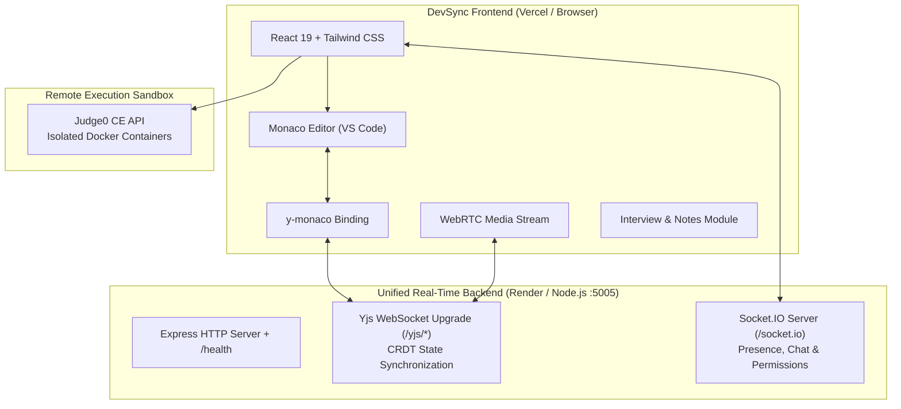

# ⚡ DevSync — Next-Gen Collaborative Cloud IDE

<p align="center">
  
  
  
  
  
  
  
  
</p>

<p align="center">
  <strong>DevSync</strong> is a high-performance, real-time collaborative cloud IDE tailored for remote engineering teams, technical hiring interviews, pair programming, and coding education. Featuring conflict-free multi-cursor editing with member-matched blinking cursors, peer-to-peer video/audio calling, instant code execution across 10+ languages, live web previews, responsive mobile editing, and structured interview evaluation tools.
</p>

<p align="center">
  <a href="https://dev-sync-dusky.vercel.app" target="_blank">
    
  </a>
  <a href="https://devsync-collaborative-ide.onrender.com/health" target="_blank">
    
  </a>
</p>

---

## 📑 Table of Contents
- [✨ Key Features](#-key-features)
  - [1. Real-Time Multi-Cursor Collaboration](#1-real-time-multi-cursor-collaboration)
  - [2. Integrated WebRTC Voice & Video Calling](#2-integrated-webrtc-voice--video-calling)
  - [3. Technical Interview & Assessment Suite](#3-technical-interview--assessment-suite)
  - [4. Remote Code Execution Engine](#4-remote-code-execution-engine)
  - [5. Instant Live Web Preview](#5-instant-live-web-preview)
  - [6. Virtual File System & Global Search](#6-virtual-file-system--global-search)
  - [7. Host Security & Granular Access Control](#7-host-security--granular-access-control)
  - [8. Mobile-Responsive IDE Experience](#8-mobile-responsive-ide-experience)
- [🏗️ System Architecture](#️-system-architecture)
- [🛠️ Tech Stack](#️-tech-stack)
- [🚀 Quickstart & Local Setup](#-quickstart--local-setup)
- [📁 Project Structure](#-project-structure)
- [🌐 Deployment (Render + Vercel) & Tunneling](#-deployment-render--vercel--tunneling)
- [🤝 Contributing](#-contributing)
- [📄 License](#-license)

---

## ✨ Key Features

### 1. Real-Time Multi-Cursor Collaboration
- **Zero-Conflict Synchronization:** Powered by **Yjs CRDTs (Conflict-free Replicated Data Types)** with WebSocket relays for sub-millisecond updates across all connected peers.
- **Member-Matched Blinking Cursors & Presence:** Deterministic hash-based colors for every collaborator—both your local blinking cursor and every remote collaborator's blinking cursor and selection highlight match the exact colored dot beside their name in the Live Session panel.
- **Monaco Editor Core:** Full VS Code editing power — syntax highlighting, bracket matching, intellisense, multi-selection, and code folding.

### 2. Integrated WebRTC Voice & Video Calling
- **Native Peer-to-Peer Calls:** Crystal-clear audio and video streams right inside the IDE without third-party tools like Zoom or Google Meet.
- **Floating Video Feeds & Controls:** Draggable and minimizeable video grid with mute/unmute, camera toggle, and network state indicators.
- **Audio Signaling:** Real-time socket signaling for incoming call notifications, ringtones, and connection handshakes.

### 3. Technical Interview & Assessment Suite
- **Curated Problem Library:** Built-in repository of algorithm and system design problems (Easy, Medium, Hard) with descriptions, constraints, examples, and test cases.
- **Interviewer Notes & Rubrics:** Private, persistent evaluation panel for scoring problem-solving, code quality, communication, and overall hiring recommendations.
- **Timer & Candidate Management:** Track time elapsed and candidate status seamlessly during live interview rounds.

### 4. Remote Code Execution Engine
- **Sandboxed Execution via Judge0:** Run code directly from the IDE in isolated containers supporting **Python, JavaScript, TypeScript, C++, Java, Rust, Go, C#, PHP, and Ruby**.
- **Interactive "Thunder" Terminal:** Custom interactive terminal supporting standard input (stdin), execution logs, ANSI color parsing, and command history (Arrow Up/Down).

### 5. Instant Live Web Preview
- **Zero-Refresh Rendering:** Split-screen browser preview that renders HTML, CSS, and vanilla JavaScript changes instantly as you type.
- **Responsive Viewport Toggles:** Test web designs across desktop, tablet, and mobile device breakpoints inside the preview panel.

### 6. Virtual File System & Global Search
- **Nested Tree Explorer:** Create, rename, delete, and organize files and nested directories effortlessly.
- **Global Search & Replace:** Instant multi-file keyword search with match highlighting and batch replace capabilities.
- **Multi-Tab Management:** Fast tab switching, unsaved change indicators, and file icon support.

### 7. Host Security & Granular Access Control
- **Lobby & Join Approvals:** Room hosts can approve or reject incoming join requests.
- **Role-Based Permissions:** Grant `Editor` (read/write) or `Viewer` (read-only) permissions dynamically to participants to prevent tampering during demos or exams.

### 8. Mobile-Responsive IDE Experience
- **Slide-Over Explorer Drawer:** Automatically collapses the sidebar on mobile viewports (`< 768px`) so the editor fills the screen, opening as an overlay drawer with backdrop and auto-close on file selection.
- **Compact Mobile Header & Scrollable Menu Bar:** Quick-access **Sidebar**, **Run**, **Live Preview**, and **Terminal** controls paired with a horizontally scrollable `File / Edit / Selection / View / Go / Run / Terminal / Help` bar and viewport-clamped dropdowns.
- **Touch-Optimized Editor:** Disables the Monaco minimap and extra gutters on narrow screens and uses `100dvh` framing so mobile browser chrome never clips the status bar.

---

## 🏗️ System Architecture



---

## 🛠️ Tech Stack

| Domain | Technology | Description |
| :--- | :--- | :--- |
| **Frontend Framework** | `React 19` + `Vite 8` | High-speed component rendering and instant HMR |
| **Editor Engine** | `Monaco Editor` (`@monaco-editor/react`) | Industrial-grade code editing experience |
| **State Synchronization** | `Yjs` + `y-websocket` + `y-monaco` | Conflict-free Replicated Data Type (CRDT) sync |
| **Video/Voice Calls** | `WebRTC` + `Socket.io` | Low-latency P2P media streaming and signaling |
| **Code Sandbox** | `Judge0 CE API` | Secure remote code execution across 10+ languages |
| **UI & Styling** | `TailwindCSS v4` + `Vanilla CSS` | Modern glassmorphism & responsive layouts |
| **Icons & Animations** | `Lucide React` + `Framer Motion` | Sleek interactive controls and transitions |
| **Backend & Relay** | `Node.js`, `Express`, `ws`, `Socket.io` | WebSocket servers for collaboration and rooms |

---

## 🚀 Quickstart & Local Setup

### Prerequisites
- **Node.js**: `v18.0.0` or higher
- **npm** or **yarn** / **pnpm**

### 1. Clone the Repository
```bash
git clone https://github.com/Kushalraj123/DevSync-Collaborative-IDE.git
cd DevSync-Collaborative-IDE
```

### 2. Install Dependencies
Install frontend and standalone server dependencies:
```bash
npm install
npm --prefix server install
```

### 3. Run the Development Environment

`server/server.js` runs both the **Socket.IO server** (`/socket.io`) and the **Yjs CRDT WebSocket server** (`/yjs/*`) on port `5005`, and `vite.config.js` proxies both automatically.

#### Option A: Run Backend + Frontend Simultaneously (Recommended)
```bash
npx concurrently "npm run server" "npm run dev"
```

#### Option B: Run in Separate Terminals
```bash
# Terminal 1: Start Unified Backend Server (Socket.IO + Yjs on :5005)
npm run server

# Terminal 2: Start Frontend Dev Server (Vite on :5173)
npm run dev
```

Navigate to `http://localhost:5173` to open DevSync!

---

## 📁 Project Structure

```text
DevSync-Collaborative-IDE/
├── server/
│   ├── server.js              # Unified Express, Socket.IO & Yjs WebSocket server (+ /health)
│   ├── yjs-server.js          # Optional standalone Yjs CRDT relay server
│   └── package.json           # Standalone server dependencies (deployed on Render)
├── src/
│   ├── assets/                # Static assets, branding, and icons
│   ├── components/
│   │   ├── ActivityBar/       # Leftmost icon navigation bar with sidebar toggle
│   │   ├── BottomPanel/       # Thunder terminal, live preview & output tabs
│   │   ├── EditorArea/        # Monaco editor, tabs, and color-matched blinking cursors
│   │   ├── Interview/         # Interview question runner & private notes
│   │   ├── Landing/           # Landing page with instant room creation & templates
│   │   ├── Modals/            # Video call modal, permission alerts & join requests
│   │   ├── Sidebar/           # File explorer, search, live users & extensions (mobile drawer)
│   │   ├── StatusBar/         # Responsive bottom status bar
│   │   └── TopBar/            # Desktop menu bar & mobile quick-action header
│   ├── context/               # Global React context (Rooms, Collaboration, Auth, Editor)
│   ├── hooks/                 # Custom WebRTC (useWebRTC) & responsive (useIsMobile) hooks
│   ├── utils/                 # Socket client, Judge0 compiler, file icons & file system
│   ├── App.jsx                # Root application layout & state machine
│   ├── index.css              # Global styles, mobile viewport & cursor animations
│   └── main.jsx               # React entrypoint
├── public/                    # Static public assets
├── .env.example               # Frontend environment variable template (VITE_BACKEND_URL)
├── render.yaml                # Render Blueprint config for standalone backend deployment
├── vercel.json                # Vercel config for Vite frontend & SPA rewrites
├── package.json               # Root dependencies & scripts
├── vite.config.js             # Vite configuration & dev WebSocket proxies
└── README.md                  # Project documentation
```

---

## 🌐 Deployment (Render + Vercel) & Tunneling

DevSync is pre-configured for split production hosting with the **Backend on Render** and the **Frontend on Vercel**.

### 1. Deploy Backend on Render
1. Go to [Render Blueprints](https://dashboard.render.com/blueprints) → **New Blueprint Instance** → select this repository.
   - Or create a **Web Service** manually with:
     - **Root Directory:** `server`
     - **Build Command:** `npm install`
     - **Start Command:** `npm start`
     - **Health Check Path:** `/health`
2. Verify your live backend at `https://<your-render-service>.onrender.com/health` (`{"status":"ok"}`).

### 2. Deploy Frontend on Vercel
1. Go to [Vercel New Project](https://vercel.com/new) → import this repository (leave **Root Directory** at the repo root; `vercel.json` is auto-detected).
2. Add the Environment Variable (see `.env.example`):
   ```env
   VITE_BACKEND_URL=https://<your-render-service>.onrender.com
   ```
3. Click **Deploy**. *(Optional: set `CORS_ORIGIN` on Render to your Vercel URL to restrict origins.)*

### Local Tunneling (Quick Testing)
To share a local dev instance over the internet:

```bash
# Using Cloudflare Tunnel:
cloudflared tunnel --url http://localhost:5173

# Using Localtunnel (or `npm run share`):
npx localtunnel --port 5173

# Using Pinggy Tunnel:
ssh -p 443 -R0:localhost:5173 a.pinggy.io -o StrictHostKeyChecking=no
```

---

## 🤝 Contributing

Contributions are what make the open-source community an amazing place to learn, inspire, and create. Any contributions you make are **greatly appreciated**.

1. Fork the Project
2. Create your Feature Branch (`git checkout -b feature/AmazingFeature`)
3. Commit your Changes (`git commit -m 'Add some AmazingFeature'`)
4. Push to the Branch (`git push origin feature/AmazingFeature`)
5. Open a Pull Request

---

## 📄 License

Distributed under the **MIT License**. See `LICENSE` for more information.

---

<p align="center">
  Made with ❤️ for developers, educators, and teams worldwide.
</p>